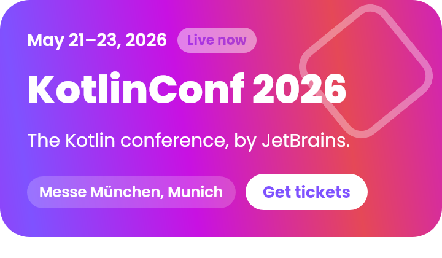
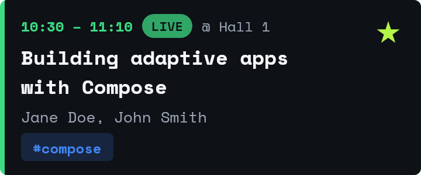
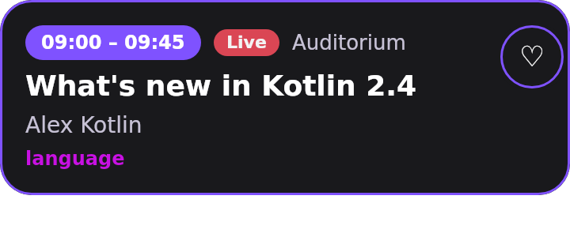
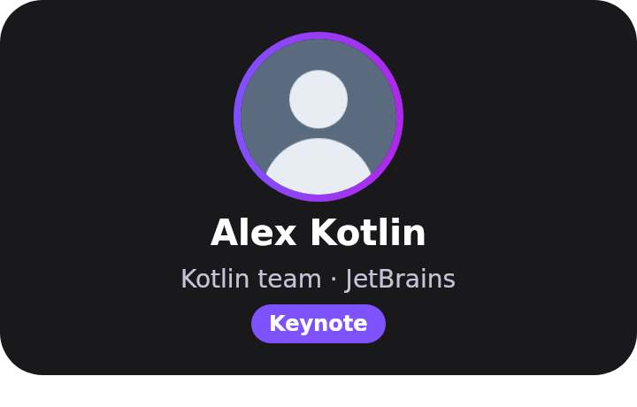
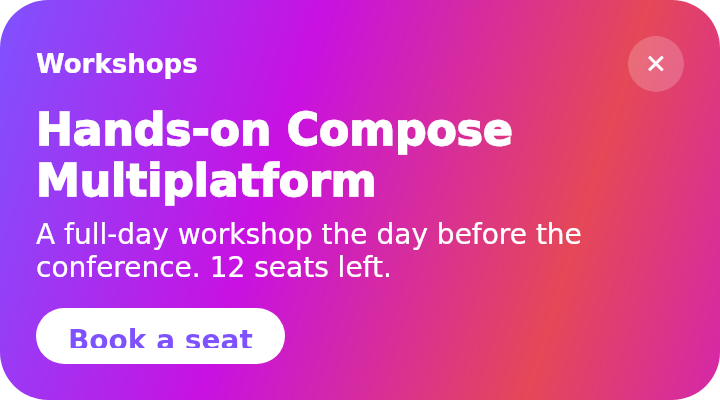
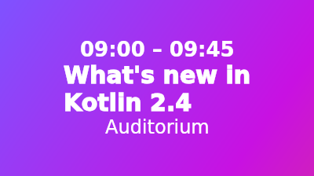
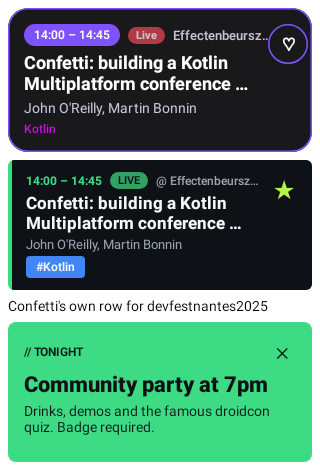
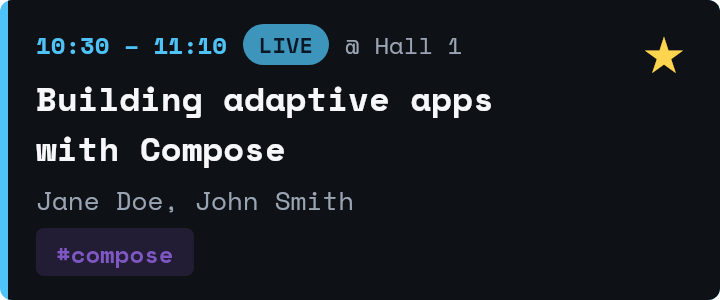

# Conference-styled Confetti, with Livery

An exploration of adopting [Livery](https://github.com/yschimke/livery) (server-driven Remote
Compose templates) in Confetti: each conference gets its own look for headers, sessions,
speakers and promotions, across form factors, and the look can change without an app release.

Two conferences are designed here: **droidcon** (dark, terminal-flavoured, Android green) and
**KotlinConf** (the Kotlin gradient, soft corners, a gradient that drifts on the player's clock).

| | droidcon | KotlinConf |
| --- | --- | --- |
| Header |  |  |
| Session |  |  |
| Speaker |  |  |
| Promotion |  |  |
| Launcher widget |  |  |
| Wear widget |  |  |

### In the app

The real Android path (`LiverySlotsTest`): the catalog bundled into the APK by Livery's Gradle
plugin, picked by conference series, filled through the contract and played inside Confetti's
agenda. A conference with no designs (`devfestnantes2025`) keeps Confetti's own row, and the
droidcon party promotion comes from a placement rule in the catalog.



### An admin's change, as data

The same droidcon documents with a different theme pack (a venue blue for droidcon Berlin): no
new capture, no app release, just values.

| droidcon (catalog theme) | droidcon, Berlin theme pack |
| --- | --- |
|  |  |
|  |  |
|  |  |

## How it fits together

```
livery-contracts/   Contracts.kt: the four contracts, typed (KMP: Android, iOS, JVM, wasm)
        │  used by both sides
        ├── livery-catalog/   designs as @RemoteComposable functions (rc-players' CMP fork of
        │                     remote-creation-compose), captured to .rc on the JVM, plus
        │                     catalog/themes and catalog/placements (data)
        │       └── catalog/  a Livery catalog source tree: what `livery build` publishes
        │
        └── shared/ui/livery  ConferenceSlot / PromoSlot: contract-typed slots in the shared
                              Compose UI, each with Confetti's own UI as the fallback
androidApp/livery/            the repository (catalog bundled into assets by Livery's Gradle
                              plugin) provided as LocalLiveryStyling
```

```bash
./gradlew :livery-catalog:generateLiveryCatalog   # capture designs, write catalog/ and renders/
./gradlew :livery-catalog:test                    # contract checks; catalog/ matches the sources
./gradlew :livery-contracts:jvmTest
```

## The contract

The contract between the app and a design is the one thing both sides must agree on, so it's
enforced at every step. `Contracts.kt` is the source of truth:

1. **Types.** Designs read `input(SessionContract.title)` and emit `emit(SessionContract.open)`,
   not strings. The app builds data with `SessionContract.data(mapOf(SessionContract.title to …))`.
   Renaming an input breaks both sides at compile time.
2. **Capture.** A template captured for one contract that reads another contract's input fails
   the capture. `reads` and `emits` in each `<template>.json` are recorded while capturing, so
   they can't drift from the document.
3. **Generation checks** (`CatalogTest`): every example binds through Livery's `ContractBinder`
   (the gate devices use), every design emits each of its contract's actions and shows every
   required input, theme packs only set theme roles, and placements carry data their design's
   contract accepts. The checked-in `catalog/` must equal what the sources generate.
4. **Livery's publisher**: `livery build --inspect` decodes every `.rc` and checks it against its
   sidecar (the Android build runs this through the Gradle plugin).
5. **Runtime**: binding refuses unknown or over-long values, so the app trims first
   (`Input.fit`). An action the contract doesn't declare, or a URL outside the allowlist, is
   dropped.

Contracts evolve per Livery's rules: within a major, only add optional inputs and actions.

| Contract | Data from | Inputs | Actions |
| --- | --- | --- | --- |
| `confetti/conference@1` | app | name, dates, location, tagline, live, ticketsUrl | tickets (open-url) |
| `confetti/session@1` | app | title, speakers, room, time, tag, live, bookmarked | open, bookmark |
| `confetti/speaker@1` | app | name, tagline, photo, sessions | open |
| `confetti/promo@1` | decision | eyebrow, headline, body, cta, url | cta (open-url), dismiss |

Every contract also takes the conference palette as theme roles (`theme.primary`, …).

## What each of the four goals looks like

1. **Conference-styled components.** Designs carry a `series` tag (`droidcon`, `kotlinconf`);
   the app maps a conference id to its series (`ConferenceSeries`) and asks for that tag. A
   conference with no designs keeps Confetti's UI, as does any platform that hasn't provided
   `LocalLiveryStyling`.
2. **Conference assets.** The header shows the conference's own branding and copy, and a theme
   pack per series (`catalog/themes/`) holds the palette as data: change a colour there and every
   template follows, with no new document.
3. **Promotions.** `catalog/placements/` holds rules for `home.feed`, `session.footer` and
   `speaker.footer`: schedules, conference segments (`conference:<id>`), sticky rollouts and
   frequency caps, decided on the device. A promotion server could answer the same placements
   later (`FirstDecider`).
4. **Animation and polish.** Animations are remote expressions on the player's clock, not
   recomposition: the "live" pills breathe, the KotlinConf gradient drifts and its diamond
   turns. They cost nothing on the app side and work in a widget host that can play them.

## Form factors

| Surface | Status here |
| --- | --- |
| Phone and tablet (Android) | Wired: agenda header, promotion and session cards, promotions under sessions and on speaker pages. On by default; `-Pconfetti.livery=false` builds the app with Confetti's own UI everywhere |
| iOS, desktop, web | The same shared slots compile for every target; each platform needs only to provide `LocalLiveryStyling` (a repository and a bundled or hosted catalog) |
| Launcher widget | Templates authored (`launcher` target); next: a `LiveryLauncherWidgetProvider` for "next session" |
| Wear | Templates authored (`wear-widget`, `wear:large`); next: a `LiveryWearWidget` beside the existing tiles |

## An admin changing a design from the app

Livery already has the pieces for an agent to change a design safely; the flow for a
conference admin would be:

1. In the app (admin role), long-press a styled slot and write a request ("make the droidcon
   header say Berlin and use the blue from the venue"). The app sends it with the slot's
   design id, contract and current data to an agent session.
2. The agent works on this source tree through `livery-mcp` (`livery-mcp livery-catalog/catalog
   --write --preview-out …`): `get_contract` for what it may use; data-only changes (copy, a theme
   pack's colours, a placement's schedule) are JSON edits checked by `validate_data`; a layout
   change edits the design's Kotlin and is re-captured. `render_preview` shows the result.
3. `build_preview` / `publish_preview` publish an unsigned preview channel; the admin's debug
   build plays it in place, with their real data.
4. Approved, it becomes a PR here: CI runs `CatalogTest` and `livery build --inspect`, then
   `livery check` against main marks any contract change that isn't compatible. Merging signs
   and publishes the catalog; apps pick it up on their next refresh.

The strong contract is what makes this safe: an agent can change everything about a design
except what it reads and emits, and anything that would break the app fails before review.
Most admin requests are data (copy, colours, schedules), which is why the palette lives in theme
packs and promotions in placements, not in the documents.

## Friction, and what changed in Livery

Found doing this, fixed in [yschimke/livery#14](https://github.com/yschimke/livery/pull/14) and
released in Livery 0.2.0, which this branch uses:

- **Compose version.** Livery 0.1.1 is built against Compose Multiplatform 1.13.0-beta02. Confetti
  pins the stable androidx Compose BOM (runtime 1.12.1), so the app compiles and then every slot
  crashes with `NoSuchMethodError`. It also pulls a beta CMP into `shared`'s other targets. 0.2.0
  builds on stable 1.12.2.
- **Bundled catalog without placements or themes.** `manifest()` is only the downloaded catalog,
  so a fresh install never decided a placement. 0.2.0 adds `current()` and `theme(id)`, which
  `LiveryStyling` uses.
- **Opaque agent errors.** `livery-mcp` said "internal error" when Skia failed to load on a
  headless host. It now says why and how to fix it.
- **Stale getting-started step**, pointing at a snapshot composite build.

Still open:

- **Slot height.** An in-app slot is as tall as the document's capture size, not its content at
  the slot's width, so text that wraps more is clipped. This needs wrap-content measurement in
  the player, or a size hint per template.
- **Action arguments.** Only a bare text value maps to an argument (`value`), so `open-url` builds
  `{"url":"…"}` as a string in the document.
- **Authoring.** Sidecars and typed contracts are hand-rolled here (`Authoring.kt`,
  `Contracts.kt`). Livery's authoring work could absorb both: record reads and emits at capture,
  and generate or check contracts from Kotlin.
- **Example data as initial values.** A host pushes only the inputs it binds, so a document's
  initial values show whenever the app leaves an optional input out. Captured with example data,
  they looked like real data. Here the capture uses contract defaults and `CatalogTest` guards
  it. Livery's authoring tools should do the same, or a host could reset unbound reads.
- A placement's segments must match the conference id exactly (`conference:droidconlondon2026`).
